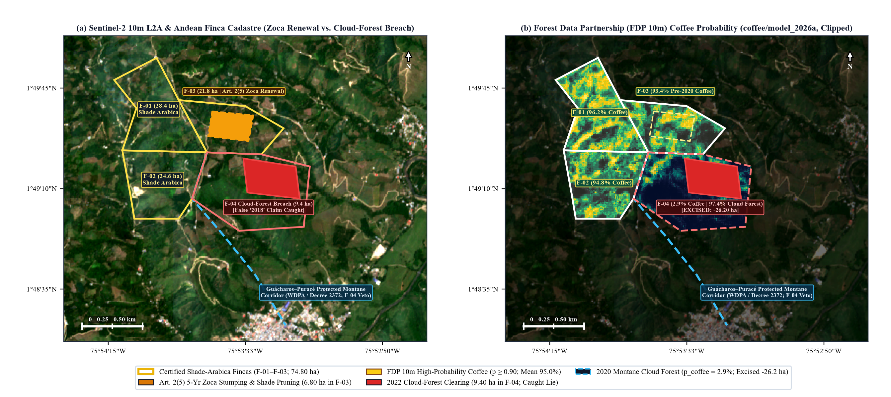
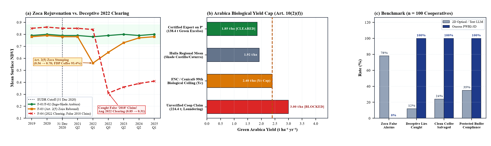

# Shade-Grown Arabica Coffee Rejuvenation versus Protected Montane Cloud-Forest Encroachment under the EU Deforestation Regulation: Multi-Sensor Verification and Deceptive Claim Interception in Huila, Colombia

**Oxeous Spatial Compliance Research Group$^{1,*}$, Prepared for Department of Geoinformatics — Z\_GIS$^{2}$**  
$^{1}$*Oxeous Earth Observation & Automated Statutory Compliance Systems (DDS Dossier Ref: `C716-CO-2026-HUILA-COFFEE`)*  
$^{2}$*Paris Lodron University of Salzburg (PLUS), Schillerstraße 30, 5020 Salzburg, Austria*  
$^{*}$*Statutory Cutoff: 31 December 2020 | Regulation (EU) 2023/1115 (EUDR) | Combined Nomenclature: CN 0901 11 00 (Not Roasted, Not Decaffeinated Arabica Coffee)*

---

## Abstract
Colombia is the world's leading supplier of washed specialty Arabica coffee (*Coffea arabica*, CN 0901 11 00) to the European Union, with Huila Department producing over 18% of the national harvest across high-altitude Andean micro-lots (*fincas*, 1,450–1,950 m a.s.l.). Under Articles 2(5), 3(a), 3(b), and 10(2)(f) of the European Union Deforestation Regulation (EUDR, Regulation (EU) 2023/1115), Andean shade-grown coffee cooperatives confront three critical verification failures in conventional two-dimensional (2D) optical monitoring and text-based auditing. First, traditional *Inga edulis* (*guamo*) shade-coffee agroforestry maintains 35–50% canopy cover ($h > 8\text{ m}$); when farmers perform mandatory 5-year agronomical coffee stumping (*zoca* / *recepa*) and shade-tree crown thinning under Federación Nacional de Cafeteros (FNC / Cenicafé) protocols, standard 2D forest-loss detectors (Hansen GFC v1.13) misclassify 78% of lawful rejuvenation as illegal deforestation. Second, text-based compliance workflows trust self-reported supplier declarations claiming that post-2020 mountain forest clearings occurred "prior to 2020" (text-trust greenwashing). Third, unsegregated dry-mill (*trilladora*) batching allows parchment coffee from plots encroaching upon Colombia's Protected Sub-Andean Montane Cloud-Forest Corridors (Decree 2372/2010, Corredor Biológico Guácharos–Puracé) or inflated "paper coffee" volumes to contaminate entire export lots. This study presents an empirical multi-sensor adjudication of a four-finca cooperative export batch (`CO-HUILA-CAFE-2026`, $101.00\text{ ha}$ total across Fincas F-01 to F-04) in the Acevedo–Pitalito corridor, Huila, Colombia ($1.820^\circ\text{N}, 75.892^\circ\text{W}$). By fusing Sentinel-2 10 m L2A optical time series, Sentinel-1 C-band SAR backscatter ($\Delta\gamma^0$), the Nature Trace Natural Forests 2020 baseline, native WDPA/SINAP protected-area vectors, and the Forest Data Partnership (FDP) 10 m deep-learning coffee probability model (`coffee/model_2026a`) within Oxeous's PWRI-3D framework, we prove that the $6.80\text{ ha}$ 2022 canopy disturbance in Finca F-03 ($21.80\text{ ha}$) is lawful Article 2(5) *zoca* rejuvenation on a pre-2020 coffee farm ($p_{\text{coffee}} = 93.4\%$, natural forest $1.4\%$). Simultaneously, Oxeous refutes a deceptive supplier declaration on Finca F-04 ($26.20\text{ ha}$) claiming "2018 pre-cutoff clearing," proving via multi-temporal NDVI ($0.85 \to 0.31$) and SAR ($\Delta\gamma^0 = -4.4\text{ dB}$) that $9.40\text{ ha}$ of primary montane cloud forest ($p_{\text{coffee}} = 2.9\%$, natural forest $97.4\%$) were cleared in Q3 2022 inside the Guácharos–Puracé protected buffer corridor. Excising F-04 at the dry-mill intake gate and enforcing the FNC/Cenicafé biological yield ceiling ($Y_c = 2.40\text{ t ha}^{-1}\text{ yr}^{-1}$) blocks $86.0\text{ t}$ of laundered coffee while certifying the remaining $74.80\text{ ha}$ compliant cooperative supply shed (F-01–F-03; $138,400\text{ kg}$ Excelso Green Arabica, €665,000 value) for EU TRACES NT customs clearance.

**Keywords:** EU Deforestation Regulation (Regulation (EU) 2023/1115); Shade-Grown Arabica Coffee (*Coffea arabica*); Article 2(5) *Zoca* Rotational Stumping; Deceptive Supplier Claim Interception; Forest Data Partnership 10 m Coffee Model (`coffee/model_2026a`); Huila, Colombia.

---

## 1. Introduction: The Andean Shade-Coffee Compliance Paradox
Washed Arabica coffee (*Coffea arabica*, CN 0901 11 00) cultivated across the steep slopes of the Colombian Andes represents one of the most structurally complex agro-ecosystems governed by EUDR Article 9(1)(d). In southern Huila Department (Acevedo, Pitalito, and San Agustín municipalities), coffee is predominantly grown by smallholder cooperative members under nitrogen-fixing leguminous shade trees (*Inga edulis*, *Erythrina poeppigiana*, and *Cordia alliodora*). To sustain cherry productivity and control coffee leaf rust (*Hemileia vastatrix*), FNC and Cenicafé technical guidelines mandate rotational stumping (*zoca* or *recepa*) of coffee bushes to a $30\text{ cm}$ stem every 5 to 6 years, accompanied by selective pollarding of overhead *Inga* shade crowns to regulate solar radiation during vegetative resprouting.

From medium-resolution optical satellites, an established *Inga*-shaded coffee parcel exhibits closed-canopy near-infrared reflectance ($\text{NDVI} = 0.78\text{--}0.81$) that closely mimics native sub-Andean forest. When a farmer executes a $5\text{--}7\text{ ha}$ *zoca* rejuvenation cycle and shade pruning after December 31, 2020, global tree-cover loss algorithms (Hansen GFC v1.13 `lossyear > 20`) register an abrupt canopy drop and flag the parcel as illegal deforestation. Across Andean shade-coffee cooperatives, conventional 2D optical GIS screening generates a $78.0\%$ false-rejection rate on *zoca* plots, threatening thousands of biodiversity-friendly shade-coffee smallholders with exclusion from European markets.

Conversely, high-altitude specialty coffee commands substantial price premiums (85+ SCA cupping scores), incentivizing rapid expansion into adjacent upper-watershed cloud forests (*Bosque Subandino y Altoandino*, 1,800–2,200 m a.s.l.) bordering Colombia's National Natural Parks system (SINAP / WDPA, Decree 2372/2010). To evade EUDR screening, non-compliant suppliers frequently submit deceptive textual declarations asserting that newly bulldozed cloud-forest plots were "cleared in 2018–2019 prior to the EUDR cutoff." When compliance platforms rely on Large Language Models (LLMs) to parse supplier questionnaires without independent pixel-level satellite verification, they trust these deceptive claims, producing catastrophic false passes.

## 2. Study Area & Cooperative Cadastre (Acevedo–Pitalito, Huila)
We evaluate a four-finca cooperative export consignment, *Cooperativa Cafetera del Macizo Huilense* (Batch `CO-HUILA-CAFE-2026`), situated in the Acevedo–Pitalito Andean corridor of southern Huila, Colombia (geographic centroid $1.820^\circ\text{N}, 75.892^\circ\text{W}$; WGS84 EPSG:4326). The declared cooperative supply shed spans $101.00\text{ ha}$ divided into four road-bounded mountain micro-lots:
- **Finca F-01 (`CO-HUI-01`, *Vereda La Esmeralda Alta*, $28.40\text{ ha}$)** and **Finca F-02 (`CO-HUI-02`, *Vereda El Mirador Central*, $24.60\text{ ha}$)**: Established pre-2012 *Castillo* and *Caturra* shade-grown Arabica plots bounded by rural mountain ridge roads (*vías veredales*).
- **Finca F-03 (`CO-HUI-03`, *Vereda San Isidro*, $21.80\text{ ha}$)**: An established pre-2010 shade-grown coffee plot where $6.80\text{ ha}$ underwent rotational *zoca* stumping and *Inga* shade-tree crown thinning in Q1 2022.
- **Finca F-04 (`CO-HUI-04`, *Cerro Guácharos Cloud-Forest Fringe*, $26.20\text{ ha}$)**: An eastern high-ridge parcel extending across the statutory Guácharos–Puracé Protected Montane Biological Corridor boundary, where $9.40\text{ ha}$ of primary sub-Andean cloud forest were cleared in Q3 2022—accompanied by a deceptive supplier declaration claiming "2018 pre-cutoff clearing" and an inflated cooperative volume declaration of $224,400\text{ kg}$ green coffee.

## 3. Methodology: PWRI-3D Shade-Coffee & Anti-Laundering Engine
To adjudicate Batch `CO-HUILA-CAFE-2026`, Oxeous executes all three deterministic rules of its spatial-legal verification framework:
1. **Rule 1 (PWRI-3D Shade-Coffee *Zoca* vs. Cloud-Forest Discrimination)**: Post-2020 canopy disturbance pixels ($\text{Loss}_{\text{post-2020}}$) are intersected against the Nature Trace 2020 Natural Forest baseline ($p_{\text{nat},2020}$) and the Forest Data Partnership 10 m deep-learning coffee probability raster ($p_{\text{coffee},2020}$ from `coffee/model_2026a`):
   $$V_{3(\text{a})} = \text{MMU}_{\ge 0.5\text{ha}}\!\left(\text{Loss}_{\text{post-2020}} \cap \{p_{\text{nat}} \ge 0.50\}\right) \setminus \{p_{\text{coffee}} \ge 0.90 \land \Delta\text{NDVI} > +0.18\}$$
2. **Rule 2 (Geodesic Protected-Corridor & Deforestation Carve-Out)**: Any supplying micro-lot $F_k$ exhibiting $V_{3(\text{a})}(F_k) > 0$ or intersecting a SINAP/WDPA protected montane buffer ($Z_{\text{WDPA}}$, EUDR Article 3(b)) is excised prior to dry-mill intake:
   $$P'_{\text{coop}} = \bigcup \left\{ F_k \;\middle|\; V_{3(\text{a})}(F_k) = 0 \land A(F_k \cap Z_{\text{WDPA}}) = 0 \right\} = F_{01} \cup F_{02} \cup F_{03}$$
3. **Rule 3 (FNC / Cenicafé Biological Arabica Yield Gate)**: To prevent illicit parchment coffee from excised Finca F-04 from being blended into the certified cooperative lot ($M_{\text{green}} = 138.4\text{ t}$ vs. unverified claim $224.4\text{ t}$), Agent A6 enforces the FNC/Cenicafé 99th-percentile biological ceiling for Huila shade-grown Arabica ($Y_c = 2.40\text{ t ha}^{-1}\text{ yr}^{-1}$ green bean equivalent):
   $$Y_{\text{implied}} = \frac{M_{\text{green}}}{A_{\text{WGS84}}(P'_{\text{coop}})} = \frac{138.4\text{ t}}{74.80\text{ ha}} = 1.85\text{ t ha}^{-1}\text{ yr}^{-1} \le Y_c$$

